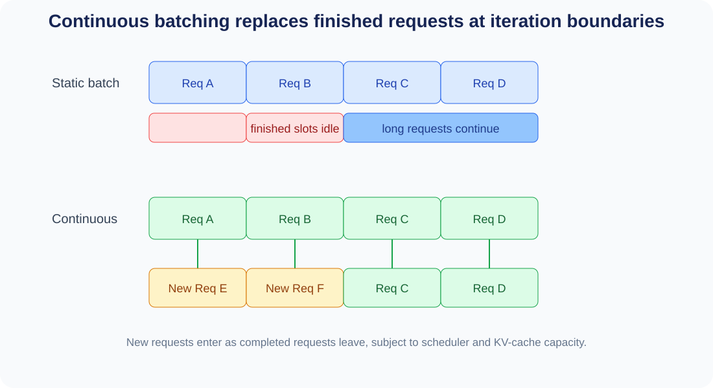

# Continuous Batching（连续批处理）

**所属分类：** [08 系统与分布式优化](README.md)  
**英文名称：** Continuous Batching / Iteration-level Scheduling  
**专题编号：** 06

## 01. 一句话定义与核心目的

**一句话定义：** Continuous Batching 是推理服务在每个生成迭代边界动态调整 Batch 中的请求，允许已完成请求退出、新请求加入，而不必等待整个静态 Batch 全部结束。

**核心目的：** 提高 GPU 在请求长度不一致、生成时间不同的场景中的利用率，减少静态 Batch 因长短请求混合而产生的空闲，并改善服务吞吐和请求等待时间。

## 02. 数学原理与核心技术

### 2.1 可视化理解

*图：静态 Batch 中短请求完成后可能留下空槽，直到长请求结束；连续批处理在迭代边界移除完成请求并填入新请求。*

### 2.2 数学原理与核心技术

设请求 $i$ 需要生成 $L_i$ 个 Token。静态 Batch 若等待最长请求完成，批次执行轮数由：

$$
L_{max}=\max_i L_i
$$

决定。较短请求在完成后对应的槽位可能无法及时用于新请求。

连续批处理在每轮生成结束后更新活动请求集合：

$$
\mathcal B_{t+1}
=
(\mathcal B_t\setminus\mathcal C_t)\cup\mathcal A_t,
$$

其中 $\mathcal B_t$ 是当前活动 Batch，$\mathcal C_t$ 是本轮完成的请求，$\mathcal A_t$ 是新加入的请求集合。

**核心技术：**
- **Iteration-level Scheduling：** 每个 Token 生成迭代后重新评估活动请求。
- **Admission Control：** 根据显存、KV Cache 和服务策略决定新请求能否进入。
- **Prefill / Decode：** Prefill 处理输入 Prompt，Decode 逐 Token 生成；两阶段计算特征不同。
- **Token Budget：** 控制每轮可处理的 Token 数量，避免单轮工作量失控。
- **Request Queuing：** 管理等待请求、优先级、超时和取消。
- **KV Cache Allocation：** 为新请求分配缓存块，完成或取消时回收资源。
- **Chunked Prefill：** 将长 Prompt 分块处理，减少 Prefill 对 Decode 的长时间阻塞。

Continuous Batching 不是简单地把 Batch Size 调大。调度器需要同时考虑请求到达、Prompt 长度、生成长度、KV Cache 容量和延迟目标；吞吐提升也可能伴随排队延迟变化。

## 03. 代表案例

| 项目 | 与本专题的关系 | 值得关注的内容 | 项目与资料 |
|---|---|---|---|
| vLLM | **直接案例：** 以迭代级调度组织在线请求和 KV Cache | scheduler、iteration-level batching、PagedAttention | [GitHub](https://github.com/vllm-project/vllm) · [论文](https://arxiv.org/abs/2309.06180) |
| Hugging Face TGI | **直接案例：** 提供动态批处理与生成式推理服务 | continuous batching、request scheduling | [GitHub](https://github.com/huggingface/text-generation-inference) |
| TensorRT-LLM | **直接案例：** 提供面向 LLM 推理的 In-flight Batching | inflight batching、KV cache manager | [GitHub](https://github.com/NVIDIA/TensorRT-LLM) |
| SGLang | **直接案例：** 面向结构化生成和高吞吐推理的请求调度系统 | scheduler、RadixAttention、request batching | [GitHub](https://github.com/sgl-project/sglang) |
