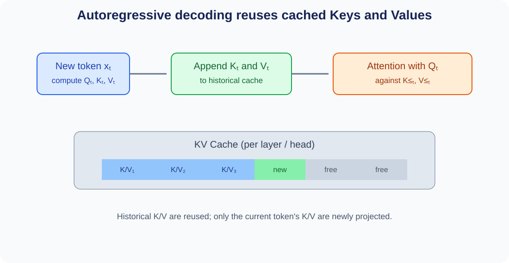

# KV Cache

**所属分类：** [08 系统与分布式优化](README.md)  
**英文名称：** Key-Value Cache  
**专题编号：** 07

## 01. 一句话定义与核心目的

**一句话定义：** KV Cache 是在自回归 Transformer 生成过程中缓存已经计算过的 Key 和 Value 张量，避免每生成一个新 Token 都重新计算历史 Token 的注意力键值。

**核心目的：** 减少逐 Token 解码时对历史上下文的重复计算，以额外显存占用换取更低的解码延迟和更高吞吐。KV Cache 的容量管理是大模型推理系统的重要瓶颈。

## 02. 数学原理与核心技术

### 2.1 可视化理解

*图：每一步只为新 Token 计算新的 K/V 并追加缓存；当前 Query 复用历史 K/V 完成因果注意力。*

### 2.2 数学原理与核心技术

### 2.1 可视化理解

### 2.2 数学原理与核心技术

对于某一层的因果自注意力：

$$
Q_t=X_tW_Q,\quad K_t=X_tW_K,\quad V_t=X_tW_V.
$$

在生成第 $t$ 个 Token 时，Query $Q_t$ 与历史及当前 Key/Value 计算：

$$
O_t=\operatorname{softmax}
\left(\frac{Q_tK_{\leq t}^{T}}{\sqrt{d_k}}\right)V_{\leq t}.
$$

若不使用 KV Cache，每一步都可能重新计算历史 Token 的 K/V 投影；使用缓存后，只需计算新 Token 的 $K_t,V_t$ 并追加到缓存。

若模型有 $L$ 层、Batch 中有 $B$ 个序列、每层有 $H_{kv}$ 个 KV Heads、每个 Head 维度为 $d_h$、缓存长度为 $S$，每个元素占 $b$ Bytes，则忽略元数据时 KV Cache 大小近似为：

$$
M_{KV}=2LBH_{kv}Sd_hb.
$$

系数 2 对应 Key 和 Value。若采用 GQA/MQA，$H_{kv}$ 可小于 Query Heads 数，从而降低缓存需求。

**核心技术：**
- **Append-only Cache：** 每次生成新 Token，将其 K/V 追加到历史缓存。
- **Paged KV Cache：** 将缓存切成固定大小 Block，按需分配，减少连续大块内存要求和碎片。
- **Prefix Sharing：** 对共享 Prompt 前缀的请求复用部分 KV Cache，需正确管理引用与生命周期。
- **KV Quantization：** 以低精度存储 K/V，减少显存，但需要验证注意力输出误差。
- **Eviction / Offload：** 在显存紧张时管理缓存淘汰或卸载，需考虑重新计算和数据搬运成本。
- **Cache Layout：** 设计 Block、Head 和 Token 维度的物理布局，影响访存合并与 Kernel 效率。

KV Cache 不是越大越好：缓存长度、并发请求数和 KV Heads 数共同决定显存占用。系统需要在请求准入、缓存块分配、前缀复用和延迟目标之间权衡。

## 03. 代表案例

| 项目 | 与本专题的关系 | 值得关注的内容 | 项目与资料 |
|---|---|---|---|
| vLLM PagedAttention | **经典直接案例：** 以分页式 KV Block 管理降低缓存碎片并支持高并发 | block table、KV block allocation、prefix caching | [GitHub](https://github.com/vllm-project/vllm) · [论文](https://arxiv.org/abs/2309.06180) |
| TensorRT-LLM | **直接案例：** 提供 KV Cache 管理、分页和复用机制 | KV cache manager、reuse、quantization | [GitHub](https://github.com/NVIDIA/TensorRT-LLM) |
| SGLang RadixAttention | **直接案例：** 通过 Radix Tree 管理和复用共享前缀 KV Cache | prefix tree、cache reuse、eviction | [GitHub](https://github.com/sgl-project/sglang) |
| Hugging Face Transformers | **基础案例：** 在模型生成接口中维护 past_key_values | cache object、dynamic/static cache | [GitHub](https://github.com/huggingface/transformers) · [文档](https://huggingface.co/docs/transformers/main/en/kv_cache) |
