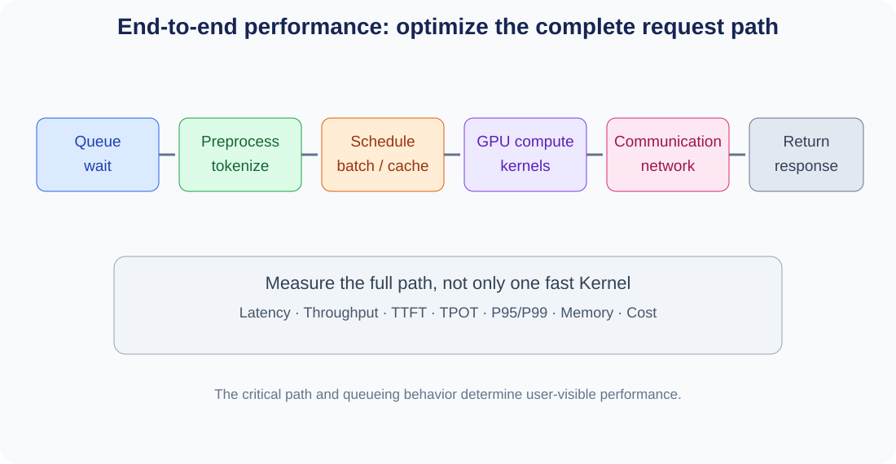

# 端到端性能优化

**所属分类：** [08 系统与分布式优化](README.md)  
**英文名称：** End-to-End Performance Optimization  
**专题编号：** 08

## 01. 一句话定义与核心目的

**一句话定义：** 端到端性能优化是从用户请求或完整训练步骤出发，联合分析模型、算子、内存、通信、调度和运行时，优化整体系统指标，而不是只优化单个 Kernel。

**核心目的：** 确保局部加速真正转化为系统级收益。一个 Kernel 变快不一定使服务更快；瓶颈可能转移到 CPU 调度、数据准备、通信、KV Cache 分配、排队或网络传输。

## 02. 数学原理与核心技术

### 2.1 可视化理解

*图：请求完整路径包括排队、预处理、调度、GPU 计算、通信和返回；端到端优化需看完整路径与用户可见指标。*

### 2.2 数学原理与核心技术

### 2.1 可视化理解

*图：端到端执行包含请求进入、排队、调度、数据准备、GPU 计算、通信和结果返回；优化需要结合系统时间线和用户可见指标定位关键路径。*

### 2.2 数学原理与核心技术

完整请求的延迟可以分解为若干阶段：

$$
T_{E2E}=T_{queue}+T_{preprocess}+T_{compute}
+T_{communication}+T_{postprocess}+T_{return}.
$$

不同阶段可能并行或重叠，因此该式是阶段归因框架，不一定是简单可相加的物理时间。

**常见系统指标：**
- **Latency：** 完成单个请求或任务所需时间。
- **Throughput：** 单位时间完成的请求数、Token 数或样本数。
- **TTFT：** Time To First Token，首 Token 延迟。
- **TPOT：** Time Per Output Token，生成阶段每个输出 Token 的平均时间，需明确统计口径。
- **P50 / P95 / P99：** 延迟分位数，用于观察典型体验与尾延迟。
- **GPU Utilization：** GPU 忙碌程度；需与实际吞吐和瓶颈指标一起解释。
- **Memory Footprint：** 权重、激活、KV Cache 和临时缓冲区等内存占用。
- **Cost per Token / Request：** 单位服务产出的资源成本。

**核心技术：**
- **Workload Characterization：** 固定并记录请求长度、Batch、并发数、输入输出分布和模型配置。
- **Critical Path Analysis：** 找出决定整体完成时间的依赖链和等待阶段。
- **System Profiling：** 联合观察 CPU、GPU、通信、内存和调度时间线。
- **Bottleneck Analysis：** 区分计算受限、带宽受限、通信受限、Launch 受限和排队受限。
- **Ablation：** 每次改变一个主要因素，测量其对系统指标的实际影响。
- **SLO-aware Optimization：** 在满足 P95/P99 延迟或其他服务目标的条件下优化吞吐和成本。
- **Reproducible Benchmarking：** 固定软件版本、硬件、输入分布、预热、计时方式和重复次数。

端到端优化应同时报告工作负载和指标口径。只报告峰值吞吐，可能掩盖排队延迟和尾延迟；只报告单 Kernel 时间，也无法代表真实在线服务体验。

## 03. 代表案例

| 项目 | 与本专题的关系 | 值得关注的内容 | 项目与资料 |
|---|---|---|---|
| vLLM | **直接案例：** 将 KV Cache、连续批处理和调度结合，优化 LLM 在线推理 | throughput、TTFT、TPOT、scheduler、PagedAttention | [GitHub](https://github.com/vllm-project/vllm) |
| SGLang | **直接案例：** 将请求调度、前缀缓存和结构化生成结合 | RadixAttention、scheduler、serving benchmarks | [GitHub](https://github.com/sgl-project/sglang) |
| NVIDIA GenAI-Perf | **直接工具：** 测量生成式 AI 服务的延迟、吞吐和 Token 指标 | TTFT、ITL、request/token throughput | [GitHub](https://github.com/triton-inference-server/perf_analyzer) |
| MLPerf Inference | **标准化基准：** 在规定场景与规则下比较推理系统性能 | scenario、latency constraints、throughput | [官网](https://mlcommons.org/benchmarks/inference/) · [GitHub](https://github.com/mlcommons/inference) |
| NVIDIA Nsight Systems | **分析工具：** 从系统时间线定位 CPU/GPU/通信和同步瓶颈 | timeline、CUDA API、GPU kernels、NVTX | [官方文档](https://docs.nvidia.com/nsight-systems/) |
